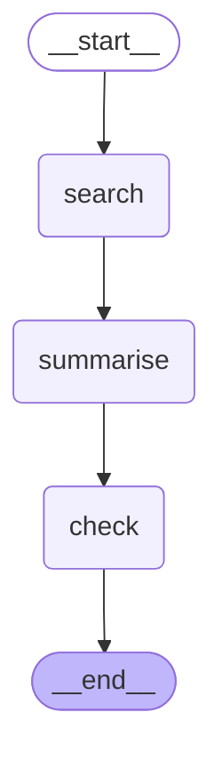

# Research Agent: Architecture

Status: **DRAFT** (updated 2026-11-10 for Stage 7, tracing). Spec: `docs/PRD.md`.

## Flow

```
query
  │
  ▼
[search node] ──uses──▶ tools/pubmed.py ──HTTP──▶ NCBI E-utilities (free, public)
  │
  ▼
[summarise node] ──▶ Claude (Anthropic API, paid; cost cap set by user)
  │
  ▼
[citation_check node] ──▶ checks each claim against the abstracts of its cited PMIDs
  │
  ▼
audit/run_log.py ──▶ runs/<run-id>.json (on disk, gitignored)
```

### Graph (generated)

Generated from the real graph by `scripts/draw_graph.py` (PRD G13). Do not edit by hand: a
test fails if this block differs from `build_graph().get_graph().draw_mermaid()`.

<!-- graph:start -->

<!-- graph:end -->

## Modules and scope

| Module | Job | May import | Stage |
|---|---|---|---|
| `tools/pubmed.py` | Search PubMed (relevance order), return `Paper`s with authors, DOI and link | `observability` only | 3, 3r |
| `observability.py` | `@traced` decorator, writes to `runs/trace.log` | standard library only | 3 |
| `state.py` | Shared types passed between nodes (`Summary`, `CheckedSummary` and their parts); graph state added in Stage 6 | `tools` (for `Paper`) | 4 to 6 |
| `nodes/search.py` | Graph node that calls the PubMed tool | `tools`, `state`, `observability` | 6 |
| `llm_common.py` | Shared Claude helpers: env settings, chat model builder, tag neutraliser | `observability` only | 5 (C-Q1) |
| `nodes/summarise.py` | Graph node: summary with PMID citations | `state`, `llm_common`, `observability`; `tools` (types: `Paper`, `SearchResult`) | 4 |
| `nodes/citation_check.py` | Graph node: verifies every claim (model verdict + quote and number checks) | `state`, `llm_common`, `observability`; `tools` (types: `Paper`, `SearchResult`) | 5 |
| `audit/run_log.py` | Writes one audit record per run; citation strings; injection-phrase scan (G12) | `state`, `observability`; `tools` (type: `Paper`) | 6 |
| `tracing.py` | Opt-in LangSmith tracing: `tracing_config`, `tracing_scope` (on/off + flush), `redact` | `observability` only | 7 |
| `graph.py` | Connects the nodes (LangGraph); wraps each run in `tracing_scope` | `nodes`, `state`, `audit`, `tracing` | 6, 7 |
| `__main__.py` | Entry point: `python -m research_agent "<query>" --yes`; spend guard, loads `.env`, prints verified claims + citations | `graph`, `audit`, `observability` | 6 |
| `scripts/draw_graph.py` | Writes the Mermaid diagram of the real graph into this file, between the markers | `graph`, `observability` | 6 |

**Rules**

- Dependencies point one way: `graph` → `nodes` → `tools`. A tool never imports a node.
- A node never imports another node. Types shared between nodes live in `state.py`; each node re-exports its own result types, so `nodes.summarise.Summary` etc. still work.
- Only `tools/` talks to NCBI. Only `nodes/summarise.py` and `nodes/citation_check.py` talk to Claude.
- Data leaves the project only through those two external calls, plus a third **only with `--trace`**: LangSmith (query, titles, abstracts, prompts, replies, claims; secrets removed by `redact`; Stage 7, T6). Everything else stays on local disk.
- Only `tracing.py` sets up tracing. Without `--trace`, tracing is switched off for the run even if `LANGSMITH_TRACING=true` (T1).

## Config

All settings come from environment variables (`.env`, template in `.env.example`):
`NCBI_EMAIL`, `NCBI_API_KEY` (optional), `ANTHROPIC_API_KEY`, `ANTHROPIC_MODEL`,
`ANTHROPIC_CHECK_MODEL` (Stage 5), `LANGSMITH_API_KEY`, `LANGSMITH_PROJECT` (Stage 7, only with `--trace`).

## Not in this design

Web UI, database, deployment, PMC full text. Each needs a PRD change first.
